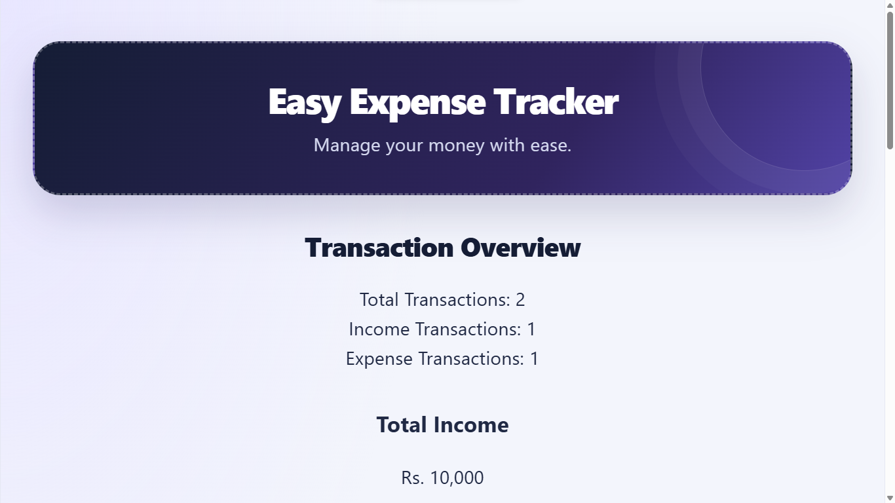

# 💰 Easy Expense Tracker

A full-stack expense tracking application built using the MERN stack. It helps users record income and expenses, track their balance, and manage financial transactions through a clean, responsive dashboard.

## 🌐 Live Demo

- **Frontend:** https://easy-expense-tracker-kappa.vercel.app
- **Backend API:** https://easy-expense-tracker-aguc.vercel.app
- **GitHub Repository:** https://github.com/junaidmukhtar152/easy-expense-tracker

## 📸 Screenshots

### Dashboard



## ✨ Features

- Add income and expense transactions
- View all saved transactions
- Edit and delete transactions
- Calculate total income and expenses
- Calculate current balance
- Search transactions by description
- Filter transactions by type
- Filter transactions by date range
- Validate transaction inputs
- Store transactions in MongoDB
- Responsive interface for desktop and mobile

## 🛠️ Technologies Used

**Frontend**

- React.js
- Vite
- JavaScript
- HTML5
- CSS3

**Backend**

- Node.js
- Express.js
- Mongoose
- CORS

**Database**

- MongoDB Atlas

**Deployment**

- Vercel

## 📁 Project Structure

```text
easy-expense-tracker/
├── backend/
│   ├── models/
│   │   └── Transaction.js
│   ├── routes/
│   │   └── transactionRoutes.js
│   ├── server.js
│   └── package.json
├── frontend/
│   ├── src/
│   │   ├── App.jsx
│   │   ├── App.css
│   │   └── main.jsx
│   ├── index.html
│   └── package.json
├── screenshots/
│   └── dashboard.png
├── .gitignore
└── README.md
```

## ⚙️ Prerequisites

Before running the project locally, install:

- Node.js and npm
- MongoDB Atlas account or a local MongoDB server
- Visual Studio Code (recommended)

## 🚀 Installation and Setup

### 1. Clone the repository

```bash
git clone https://github.com/junaidmukhtar152/easy-expense-tracker.git
cd easy-expense-tracker
```

### 2. Configure the backend

```bash
cd backend
npm install
```

Create a `.env` file in the backend folder and configure your MongoDB connection string:

```env
MONGO_URI=your_mongodb_connection_string
```

Never commit your real database password or connection string to GitHub.

Start the backend using the command appropriate for your project's server configuration.

### 3. Configure the frontend

Open a second terminal:

```bash
cd frontend
npm install
npm run dev
```

Open the local URL shown by Vite, usually:

```text
http://localhost:5173
```

## 🔌 API Endpoints

Base URL for local development:

`http://localhost:5000/api/transactions`

| Method | Endpoint | Description               |
| ------ | -------- | ------------------------- |
| GET    | `/`      | Retrieve all transactions |
| GET    | `/:id`   | Retrieve one transaction  |
| POST   | `/`      | Create a transaction      |
| PUT    | `/:id`   | Update a transaction      |
| DELETE | `/:id`   | Delete a transaction      |

## 📊 How It Works

1. The user enters a transaction description, amount, and type.
2. React sends the request to the Express backend.
3. Mongoose stores the transaction in MongoDB.
4. The frontend retrieves and displays transactions.
5. The application calculates income, expenses, and balance.
6. Search and filters help users find specific transactions.

## 🎯 Learning Outcomes

Through this project, I practiced:

- Building interfaces with React
- Managing state and form submissions
- Creating REST API endpoints
- Performing CRUD operations
- Connecting Node.js with MongoDB
- Connecting frontend and backend
- Handling form validation and errors
- Improving responsive UI/UX design
- Deploying a full-stack application

## 🔮 Future Improvements

- User registration and authentication
- Interactive financial charts
- Monthly budgets and spending reports
- Export transactions to CSV

## 👨‍💻 Author

**Junaid Mukhtar**

BS Software Engineering Student

- GitHub: https://github.com/junaidmukhtar152

## 📄 License

This project is available for learning and educational purposes. No separate open-source license is specified.
